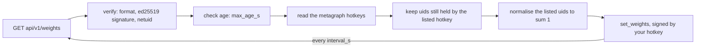
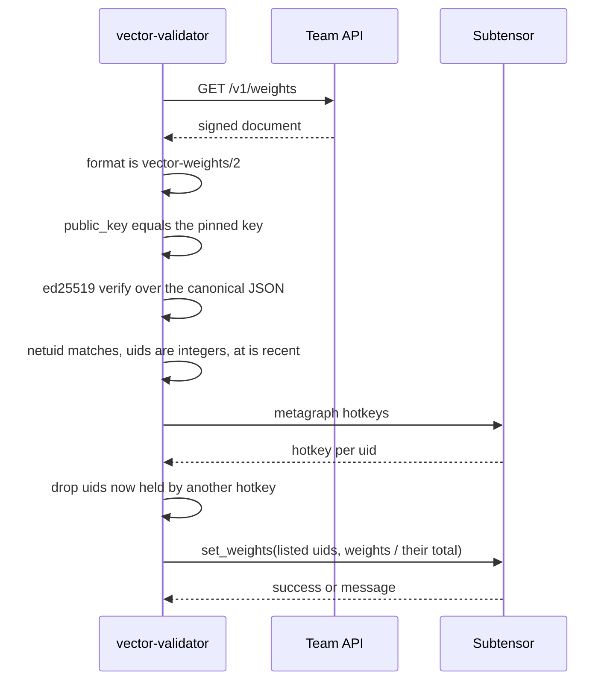

# vector-validator

The validator for the Vector subnet. The team computes the weights and publishes them as a signed
document. A validator fetches that document, checks the signature against the team's pinned ed25519 key, checks
every uid against the metagraph, and sets the weights on chain.



## Install

```bash
git clone https://github.com/robotensor/vector-validator && cd vector-validator
scripts/setup.sh               # .venv from requirements.lock (hash-pinned), this package, ./config.yaml
```

Python 3.12 (`requires-python >=3.12`, `.python-version`). `setup.sh` uses `uv` when it is installed, else
`python3 -m venv`. Without the script: `pip install --require-hashes -r requirements.lock && pip install --no-deps -e .`
in a Python 3.12 venv. `requirements.in` holds the top-level pins (`httpx`, `bittensor-wallet`, `pynacl`, `pyyaml`,
`bittensor` 11.3.5, `pytest`); `requirements.lock` pins every package with its hashes.

Bittensor 9, 10 and 11 all work. The SDK is imported only when a command needs the chain.

## Configure

`setup.sh` writes `./config.yaml` (from `vector_validator/config.example.yaml`, git-ignored). Every command below
reads it with `--config config.yaml`; or set `VECTOR_VALIDATOR_CONFIG=$PWD/config.yaml` once.

```bash
.venv/bin/vector-validator config show --config config.yaml    # every setting in effect and where it comes from (--json)
```

Fill in:

```yaml
api: https://vector.robotensor.ai
netuid: <netuid>                 # published with the subnet
weights_pubkey: <weights-pubkey> # the team's ed25519 key, 64 hex, published with the subnet
wallet:
  name: <coldkey>
  hotkey: <hotkey>
```

Without `--config` the file is `$VECTOR_VALIDATOR_CONFIG`, else `$VECTOR_VALIDATOR_HOME/config.yaml` (default
`~/.vector-validator/config.yaml`; `vector-validator config init` writes the example there). A flag beats an
environment variable, which beats the file, which beats the default.

| Setting | Flag | Environment | Default |
|---|---|---|---|
| `api` | `--api` | `VECTOR_VALIDATOR_API` | `https://vector.robotensor.ai` |
| `network` | `--subtensor.network` | `VECTOR_VALIDATOR_NETWORK` | `finney` |
| `netuid` | `--netuid` | `VECTOR_VALIDATOR_NETUID` | none (required) |
| `weights_pubkey` | `--pubkey` | `VECTOR_VALIDATOR_WEIGHTS_PUBKEY` | none (required unless dry run) |
| `wallet.name` | `--wallet.name` | `VECTOR_VALIDATOR_WALLET_NAME` | none |
| `wallet.hotkey` | `--wallet.hotkey` | `VECTOR_VALIDATOR_WALLET_HOTKEY` | `default` |
| `wallet.path` | `--wallet.path` | `VECTOR_VALIDATOR_WALLET_PATH` | `~/.bittensor/wallets` |
| `validator.interval_s` | `--interval` | `VECTOR_VALIDATOR_INTERVAL_S` | `1200` |
| `validator.max_age_s` | `--max-age` | `VECTOR_VALIDATOR_MAX_AGE_S` | `3600` (0 = no limit) |
| `validator.dry_run` | `--dry-run` / `--no-dry-run` | `VECTOR_VALIDATOR_DRY_RUN` | `false` |

`network` is `finney`, `test`, or a node endpoint such as `ws://127.0.0.1:9944`. Your hotkey must be registered on
the subnet with a validator permit.

## Run

```bash
.venv/bin/vector-validator run --config config.yaml --dry-run --once   # check one document, set nothing
.venv/bin/vector-validator run --config config.yaml --once             # one round, then exit (exit code 1 on failure)
.venv/bin/vector-validator run --config config.yaml                    # loop: one round every interval_s
```

- It refuses to start without a `netuid`.
- It refuses to start without a pinned team key, except in a dry run. A dry run without a key checks the signature
  against the key the document carries, and warns.
- A dry run without the bittensor SDK prints the weights as published, without the metagraph check.
- It warns when your hotkey is not registered on the subnet.
- Errors in one round are printed and the loop goes on. Run it under systemd, pm2 or a similar supervisor.

## The weights document

`GET https://vector.robotensor.ai/v1/weights` is public and needs no sign-in. Format `vector-weights/2`:

```
{format: "vector-weights/2", round, week, netuid, at, king_uid,
 weights: {"<uid>": w, ...}, hotkeys: {"<uid>": "<ss58>", ...},
 shares: {vector, expert, contributors}, basis: {...},
 public_key: "<64 hex>", signature: "<base64>"}
```

`weights` holds the team's weight per uid: the king's uid and the contributors' uids (see
[Rewards](https://vector.robotensor.ai/docs/rewards)). The validator sets the uids the document lists, as published. `shares` and `basis` say how the team
computed them; the validator does not recompute anything.

### How the weights are set

- The validator sets weights on exactly the listed uids (after the checks below), in the published proportions,
  and on no other uid. It adds no uid of its own.
- It divides the kept weights by their total before calling the SDK, so they sum to 1. A uid dropped by a check
  leaves the others in their published proportions.
- The SDK scales the largest weight to 65535 (u16) and the chain uses each validator's weights relative to their
  sum.
- Each round prints the document's round, its uids and `king_uid`. A dry run prints the normalised values.

The signature is ed25519 over the document without `public_key` and `signature`, as JSON with sorted keys and no
spaces (`json.dumps(body, sort_keys=True, separators=(",", ":"))`).



A document is refused when:

- the format is not `vector-weights/2`;
- it is unsigned, signed by a key other than the pinned one, or the signature does not verify;
- `weights` or `hotkeys` is missing, a weight is keyed by something other than a uid, or `netuid` is missing;
- `netuid` differs from yours;
- `at` is older than `max_age_s`.

A uid is dropped (and the rest renormalised) when it is listed twice, has no hotkey listed, is not on the subnet,
or is now held by a different hotkey than the one the team scored. So a weight never goes to whoever took over a
deregistered uid. Non-finite and non-positive weights count as 0.

## Chain calls

Two calls, in `vector_validator/chain.py`:

| Call | bittensor 11 | bittensor 9 / 10 |
|---|---|---|
| Hotkeys by uid | `Subtensor.read("neurons", netuid, lite=True)` | `Subtensor.metagraph(netuid, lite=True).hotkeys` |
| Set weights | `Subtensor.execute(bt.intents.SetWeights(...), hotkey)` | `Subtensor.set_weights(wallet, netuid, uids, weights)` |

## Tests

```bash
.venv/bin/python -m pytest
```

The tests are offline: no network and no chain.

## License

MIT.
