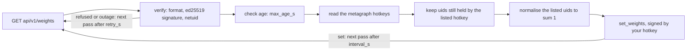
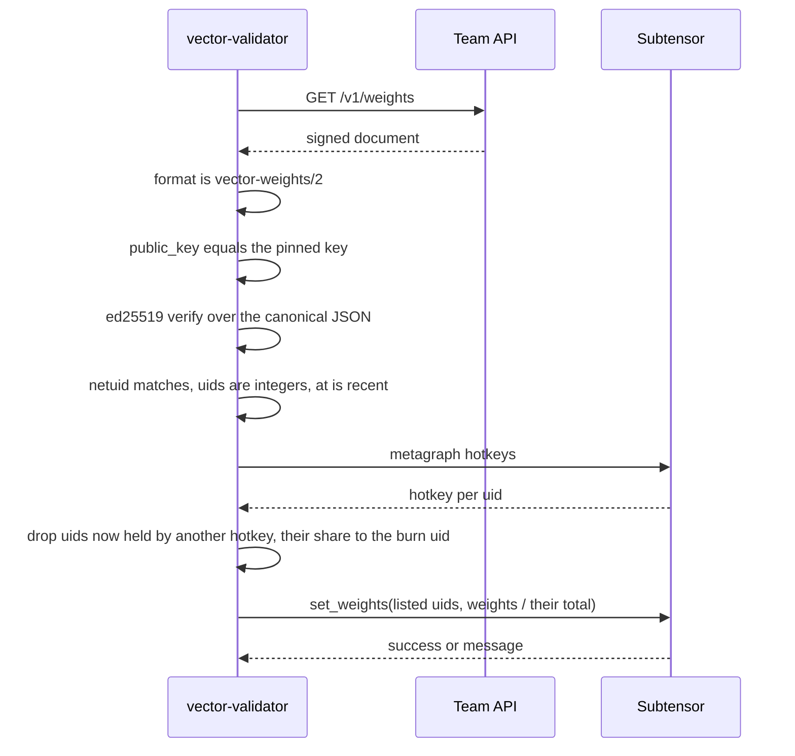

# vector-validator

The validator for the Vector subnet. The team computes the weights and publishes them as a signed
document. A validator fetches that document, checks the signature against the team's pinned ed25519 key, checks
every uid against the metagraph, and sets the weights on chain.



## Install

```bash
git clone https://github.com/robotensor/vector-validator && cd vector-validator
scripts/setup.sh               # .venv from requirements.lock (hash-pinned), this package, ./config.yaml
```

Python 3.12 (`requires-python >=3.12`, `.python-version`). `setup.sh` uses `uv` when it is installed, else
`python3 -m venv`. Without the script: `pip install --require-hashes -r requirements.lock && pip install --no-deps -e .`
in a Python 3.12 venv. `requirements.in` holds the top-level pins (`httpx`, `bittensor-wallet`, `pynacl`, `pyyaml`,
`bittensor` 11.3.5, `pytest`); `requirements.lock` pins every package with its hashes.

Bittensor 9, 10 and 11 all work. The SDK is imported only when a command needs the chain.

## Configure

`setup.sh` writes `./config.yaml` (from `vector_validator/config.example.yaml`, git-ignored). Every command below
reads it with `--config config.yaml`; or set `VECTOR_VALIDATOR_CONFIG=$PWD/config.yaml` once.

```bash
.venv/bin/vector-validator config show --config config.yaml    # every setting in effect and where it comes from (--json)
```

Fill in:

```yaml
api: https://vector.robotensor.ai
netuid: <netuid>                 # published with the subnet
weights_pubkey: <weights-pubkey> # the team's ed25519 key, 64 hex, published with the subnet
wallet:
  name: <coldkey>
  hotkey: <hotkey>
```

Without `--config` the file is `$VECTOR_VALIDATOR_CONFIG`, else `$VECTOR_VALIDATOR_HOME/config.yaml` (default
`~/.vector-validator/config.yaml`; `vector-validator config init` writes the example there). A flag beats an
environment variable, which beats the file, which beats the default.

| Setting | Flag | Environment | Default |
|---|---|---|---|
| `api` | `--api` | `VECTOR_VALIDATOR_API` | `https://vector.robotensor.ai` |
| `network` | `--subtensor.network` | `VECTOR_VALIDATOR_NETWORK` | `finney` |
| `netuid` | `--netuid` | `VECTOR_VALIDATOR_NETUID` | none (required) |
| `weights_pubkey` | `--pubkey` | `VECTOR_VALIDATOR_WEIGHTS_PUBKEY` | none (required unless dry run) |
| `wallet.name` | `--wallet.name` | `VECTOR_VALIDATOR_WALLET_NAME` | none |
| `wallet.hotkey` | `--wallet.hotkey` | `VECTOR_VALIDATOR_WALLET_HOTKEY` | `default` |
| `wallet.path` | `--wallet.path` | `VECTOR_VALIDATOR_WALLET_PATH` | bittensor default (`~/.bittensor/wallets`) |
| `validator.interval_s` | `--interval` | `VECTOR_VALIDATOR_INTERVAL_S` | `1200` |
| `validator.retry_s` | `--retry` | `VECTOR_VALIDATOR_RETRY_S` | `60` |
| `validator.max_age_s` | `--max-age` | `VECTOR_VALIDATOR_MAX_AGE_S` | `3600` (0 = no limit) |
| `validator.dry_run` | `--dry-run` / `--no-dry-run` | `VECTOR_VALIDATOR_DRY_RUN` | `false` |

`network` is `finney`, `test`, or a node endpoint such as `ws://127.0.0.1:9944`. Your hotkey must be registered on
the subnet with a validator permit.

## Run

```bash
.venv/bin/vector-validator run --config config.yaml --dry-run --once   # check one document, set nothing
.venv/bin/vector-validator run --config config.yaml --once             # one pass, then exit (exit code 1 on failure)
.venv/bin/vector-validator run --config config.yaml                    # loop: one pass every interval_s
```

- It refuses to start without a `netuid`.
- It refuses to start without a pinned team key, except in a dry run. A dry run without a key checks the signature
  against the key the document carries, and warns.
- A dry run without the bittensor SDK prints the weights as published, without the metagraph check.
- It warns when your hotkey is not registered on the subnet.
- Errors in one pass are printed and the loop goes on: the next pass comes after `retry_s` (60 s) after a failed
  pass and after `interval_s` (1200 s) after a successful one. It calls `set_weights` only when the weights differ from the ones it last set (they change only when a round ends or an evaluation is decided); otherwise the pass sets nothing. The last set is kept in `~/.vector-validator/last-set-<netuid>.json`. Run it under systemd, pm2 or a similar supervisor.
- On a refused document or an API outage nothing is set that pass, the last weights stay on chain and age out, and
  an outage longer than the subnet's activity cutoff makes the validator inactive.
- Commit-reveal: on a subnet with `commit_reveal_weights_enabled` the SDK sends a timelocked commit instead of the
  weights; the chain reveals it by itself after `commit_reveal_period` epochs, and only then does
  `Weights[netuid][your uid]` change. The pass prints `commit-reveal: committed, the chain reveals it at drand round
  <n>`; `bittensor` 11's `Subtensor.read("timelocked_weight_commits", netuid=…)` lists the pending commit and its
  `reveals_at`. No reveal call is needed.
- Rate limit: the chain accepts one set (or commit) per `weights_rate_limit` blocks. A pass inside that window fails
  with `ChainError: … last set N blocks ago; the rate limit is M blocks` and the next try comes after `retry_s`. Keep
  `interval_s` at or above `weights_rate_limit` × 12 s (the default 1200 s matches a limit of 100 blocks).

## The weights document

`GET https://vector.robotensor.ai/v1/weights` is public and needs no sign-in. While nobody but the burn uid would get weight it answers 503 and the validator sets nothing. Format `vector-weights/2`:

```
{format: "vector-weights/2", round, netuid, at, king_uid,
 weights: {"<uid>": w, ...}, hotkeys: {"<uid>": "<ss58>", ...},
 basis: {...},
 public_key: "<64 hex>", signature: "<base64>"}
```

`round` is the round both competitions share (its length is a team setting). `weights` holds the team's weight per
uid: the expert ranks' uids (ranks 1, 2 and 3 get 70 %, 20 % and 10 % of the expert part), the contributors' uids and
the burn uid for what nobody claims (see [Rewards](https://vector.robotensor.ai/docs/rewards)). `king_uid` is rank 1's
uid (else the burn uid), kept for older validators; `basis.expert = {round, ranks: [{rank, share, hotkey, uid,
registered}], burned}` lists the ranks (it replaced `basis.king`); `basis.split = {ratio, expert, contributors}` is how Vector's
share was split between the ranks and the contributors (1 : 2 by default; the team can change it). The validator sets the uids the document lists, as published. `basis` says how the team computed
them; the validator does not recompute anything.

### How the weights are set

- The validator sets weights on exactly the listed uids (after the checks below), in the published proportions,
  and on no other uid. It adds no uid of its own.
- It divides the kept weights by their total before calling the SDK, so they sum to 1. A share whose uid changed
  hands, a rank's part as much as a contributor's, goes to the document's burn uid (`basis.contributors.burn_uid`,
  the subnet owner's uid, which the chain burns) when that uid is on the subnet and, if listed, still held by the
  listed hotkey; the note names the rank (`(expert rank 2)`). A document without `burn_uid` and without
  `basis.expert` (an older document) sends it to the king instead, under the same check. Any other dropped uid leaves the
  others in their published proportions.
- The SDK scales the largest weight to 65535 (u16) and the chain uses each validator's weights relative to their
  sum.
- Each pass prints the document's `round`, its uids, `king_uid` and the expert ranks (`basis.expert.ranks`). A dry
  run prints the normalised values.

The signature is ed25519 over the document without `public_key` and `signature`, as JSON with sorted keys and no
spaces (`json.dumps(body, sort_keys=True, separators=(",", ":"))`).



A document is refused when:

- the format is not `vector-weights/2`;
- it is unsigned, signed by a key other than the pinned one, or the signature does not verify;
- `weights` or `hotkeys` is missing, a weight is keyed by something other than a uid, a listed hotkey is not a
  string, or `netuid` is missing;
- `netuid` differs from yours;
- `at` is missing, not an ISO time, older than `max_age_s`, or more than 300 s in the future (always checked,
  also with `max_age_s` 0);
- the response is not a JSON object or is larger than 16 MB.

A uid is dropped when it is listed twice, has no hotkey listed, is not on the subnet,
or is now held by a different hotkey than the one the team scored. So a weight never goes to whoever took over a
deregistered uid: a share whose uid changed hands goes to the burn uid (the owner's uid, burned by the chain), as
the team's server does for a share no registered address claims; with no usable burn uid the rest is renormalised.
Older documents (no `burn_uid`, no `basis.expert`) send it to the king's uid instead. Non-finite and non-positive weights count as 0.

## Chain calls

Two calls, in `vector_validator/chain.py`:

| Call | bittensor 11 | bittensor 9 / 10 |
|---|---|---|
| Hotkeys by uid | `Subtensor.read("neurons", netuid, lite=True)` | `Subtensor.metagraph(netuid, lite=True).hotkeys` |
| Set weights | `Subtensor.execute(bt.intents.SetWeights(...), hotkey)` | `Subtensor.set_weights(wallet, netuid, uids, weights)` |

## Tests

```bash
.venv/bin/python -m pytest
```

The tests are offline: no network and no chain. The chain calls are tested against fakes of the bittensor 11
interface (`read`, `execute`) and the bittensor 9 / 10 interface (`metagraph`, `set_weights`);
`requirements.lock` installs bittensor 11.3.5. `tests/data/weights_v2.json` is an older document made by the team server
(`vector-weights/2` with `basis.king`) and `tests/data/weights_v10.json` one in the current shape (`basis.expert` with two ranks, rank 3 empty and burned to
uid 0, `king_uid` = rank 1's uid), each signed with a test key; the contract tests check both end to end, and that a
rank uid that changed hands has its part burned.

## License

MIT.
